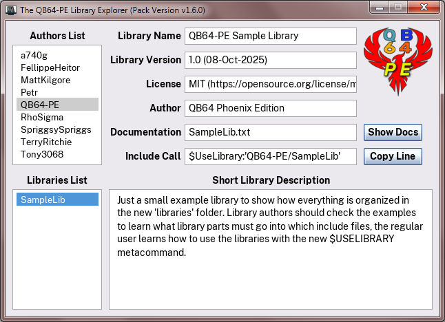

# The QB64-PE Libraries Pack
This folder contains selected user libraries from which we think they are worth to be distributed as a dedicated package for easy access and use in **QB64-PE v4.3.0 and up**. However, the libraries are not part of the QB64-PE package itself, but are hosted in its own GitHub repository as an extra add-on package. This allows us to independently update/release the libraries without the need of a complete new QB64-PE release.

As the libraries are not part of QB64-PE nor are its SUBs and FUNCTIONs part of the QB64 language, we can't guarantee they will work forever. Maintenance is under the obligation of the respective library authors. We will try to update this package as soon as possible when any of the hosted libraries got a major update, but we also reserve the right to remove a library completely if it is not properly working anymore and no longer maintained by its author.

The **Library Explorer** application can be used to easily browse through all the libraries in the Pack and get an idea of what's available. If not already done yet, you first need to compile it from the provided source code. The best place for the executable is right in the QB64-PE main folder just along the QB64pe executable, but it also works if you move it into the `libraries` folder.

## The $USELIBRARY Metacommand
### The new easy library includer!
Any of the libraries in the Pack can be easily pulled into your code with just one line containing the new `$USELIBRARY:'author/library'` metacommand ([Wiki page](https://qb64phoenix.com/qb64wiki/index.php/$USELIBRARY)) at the top of your program. This new metacommand makes sure that every required library file is automatically included in the right place to work properly. The **Library Explorer** generates the metacommand for the currently selected library and you may copy it there and then paste it into your program. Look into the folder `libraries/examples` for usage examples.

### Can I use it for other libraries too?
Not directly, the **$USELIBRARY** metacommand was especially designed to serve our new **Libraries Pack** and it depends on the layout of the `libraries` folder. However, once you understood how the data is organized within that folder, you can of course drop in other libraries to make them available for the new **$USELIBRARY** metacommand.
- If you just want to know the quick'n'dirty way how to drop in another library for your own private use, then follow the steps in the [JustDropItIn](./JustDropItIn.md) document.
- If you wanna make it correct with the intention to include the new library in the official **Libraries Pack** for all other users, then check out the [Contributors](./Contributors.md) document, you're welcome to help adding more libraries and share your work.

### Can I use it with older QB64-PE versions than v4.3.0?
No, the **$USELIBRARY** metacommand is new in **QB64-PE v4.3.0**, older versions simply don't have it.
